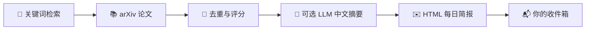

<div align="center">
  

  # 每日 arXiv 论文自动推送

  **把你关心的最新论文，整理成每天一封可读的中文邮件。**

  [](#环境要求)
  [](#开发与测试)
  [](https://arxiv.org/)
</div>

<br>

> [!IMPORTANT]
> 仓库不包含任何个人主题、API Key、邮箱地址或历史推送记录。每位使用者通过本地的 `.env` 与 `config.yaml` 完成自己的配置；这两个文件默认不会被 Git 提交。

## ✨ 它能做什么

| 主题订阅 | 智能整理 | 安全推送 |
| :--- | :--- | :--- |
| 用多个关键词持续追踪 arXiv | 去重、排序、筛选并生成中文摘要 | 邮件发送、预览模式与重复发送保护 |
| `llm agents`、`medical imaging`… | 可选接入兼容 OpenAI 的模型服务 | SMTP、Windows 任务计划、cron |



## 🚀 五分钟开始

### 1. 安装

环境要求：**Python 3.11+**，并可访问 arXiv API。

```powershell
git clone https://github.com/<你的 GitHub 用户名>/paper-digest.git
cd paper-digest
python -m venv .venv
.venv\Scripts\Activate.ps1
python -m pip install -r requirements.txt
```

<details>
<summary>Linux / macOS</summary>

```bash
git clone https://github.com/<你的 GitHub 用户名>/paper-digest.git
cd paper-digest
python3 -m venv .venv
source .venv/bin/activate
python -m pip install -r requirements.txt
```
</details>

### 2. 建立你的私有配置

```powershell
Copy-Item config.example.yaml config.yaml
Copy-Item .env.example .env
```

接下来只需编辑这两个本地文件：

| 我想调整… | 修改位置 | 例子 |
| --- | --- | --- |
| 追踪什么主题 | `config.yaml` → `keywords` | `llm agents` |
| 每天发几篇、查几天 | `config.yaml` → `top_n`、`lookback_days` | `5`、`7` |
| 偏好哪些学科 | `config.yaml` → `required_categories` | `cs.AI`、`cs.LG` |
| 使用哪个摘要模型 | `.env` → `LLM_*` | API 地址、模型名、Key |
| 发给谁 | `.env` → `SMTP_*`、`EMAIL_TO` | 你的邮箱服务 |

### 3. 先预览，后发送

```powershell
# 只生成预览，不会发邮件
python -m app.main --run-once --dry-run --debug
```

打开 `data/digest_preview.html` 检查效果。确认后再实际发送：

```powershell
python -m app.main --run-once
```

---

## ⚙️ 配置手册

### A. 定义你的论文主题 — `config.yaml`

从模板复制出的 `config.yaml` 只存在于你的电脑上。它决定“找什么论文、挑哪些论文、邮件叫什么”。

```yaml
# 每项单独向 arXiv 查询；建议使用具体的英文研究短语
keywords:
  - retrieval augmented generation
  - llm agents
  - long context language models

# 每天的筛选强度
top_n: 5                 # 最多发送几篇
lookback_days: 7         # 只关注最近几天
min_score: 4.0           # 越高，推送越少但更严格
max_results_per_keyword: 20

# 偏好分类：只会加分，不会硬性过滤其他分类
required_categories:
  - cs.AI
  - cs.LG

sort_by: submittedDate   # submittedDate / updatedDate / relevance
email_subject_prefix: "[我的论文速递]"
```

<details>
<summary><b>主题灵感（点击展开）</b></summary>

| 方向 | 可直接粘贴到 <code>keywords</code> 的主题 |
| --- | --- |
| 具身智能 | `vision language action model`、`robot manipulation`、`embodied ai` |
| 医学影像 | `medical image segmentation`、`radiology vision language model` |
| 时序 / 边缘 AI | `time series foundation model`、`edge ai`、`sensor signal understanding` |
| 多模态 | `multimodal reasoning`、`vision language model` |

常见 arXiv 分类：`cs.AI`（人工智能）、`cs.LG`（机器学习）、`cs.CL`（计算语言学）、`cs.CV`（计算机视觉）、`cs.RO`（机器人）。
</details>

### B. 接入模型与邮箱 — `.env`

```dotenv
# ── 模型服务（可选） ─────────────────────────────────────────────
# 不填写 Key 也能运行，只会使用本地兜底摘要。
LLM_API_KEY=你的模型服务_API_Key
LLM_BASE_URL=https://api.deepseek.com
LLM_MODEL=deepseek-chat

# ── 邮件服务（正式发送时必填） ─────────────────────────────────────
SMTP_HOST=smtp.example.com
SMTP_PORT=587
SMTP_USER=你的邮箱账号
SMTP_PASS=邮箱授权码
EMAIL_FROM=你的发件邮箱@example.com
EMAIL_TO=收件人1@example.com,收件人2@example.com
```

| 需求 | 该怎么填 |
| --- | --- |
| 使用 DeepSeek | `LLM_BASE_URL=https://api.deepseek.com`，模型名填服务商提供的名称 |
| 使用其他模型服务 | 该服务需兼容 OpenAI Chat Completions（`/chat/completions`）；填入其 API 地址、模型名和 Key |
| 不使用 LLM | 留空 `LLM_API_KEY`，程序会基于标题和摘要生成本地兜底内容 |
| 使用端口 465 | `SMTP_PORT=465`；程序会自动使用 SSL |
| 使用端口 587 | `SMTP_PORT=587`；程序会自动使用 STARTTLS |

> [!TIP]
> `SMTP_PASS` 通常应该是邮箱服务商生成的“应用专用密码/授权码”，不是网页登录密码。

> [!NOTE]
> 旧版 `DEEPSEEK_API_KEY`、`DEEPSEEK_BASE_URL`、`DEEPSEEK_MODEL` 仍然可用；新配置建议使用更通用的 `LLM_*`。不要同时填写两组变量。

> [!WARNING]
> 原生 Anthropic 或 Gemini API 的请求格式与 OpenAI Chat Completions 不同，当前版本不能仅替换 URL 使用；需要额外的适配器。

---

## 🕘 设为每天自动发送

<details open>
<summary><b>Windows 任务计划程序</b></summary>

创建一个“每天”触发的任务，并填写：

| 字段 | 值 |
| --- | --- |
| 程序/脚本 | `C:\path\to\paper-digest\.venv\Scripts\python.exe` |
| 添加参数 | `-m app.main --run-once` |
| 起始于 | `C:\path\to\paper-digest` |

首次设置时，建议将参数临时改为 `-m app.main --run-once --dry-run --debug`，确认预览正常后再切换为正式发送。
</details>

<details>
<summary><b>Linux / macOS cron</b></summary>

每天早上 8:00：

```cron
0 8 * * * cd /path/to/paper-digest && /path/to/paper-digest/.venv/bin/python -m app.main --run-once >> logs/cron.log 2>&1
```
</details>

---

## 🛠️ 开发与测试

```bash
python -m pytest -q
```

| 现象 | 优先检查 |
| --- | --- |
| 没有论文 | 增大 `lookback_days`、降低 `min_score`、把关键词改得更具体 |
| 模型摘要失败 | 模型服务是否兼容 `/chat/completions`，以及 `LLM_*` 是否正确 |
| 邮件发送失败 | SMTP 主机、端口、授权码、发件人与邮箱服务商限制 |
| 想重新推送 | 删除本地 `data/papers.db` 后再运行；此文件不会提交到 Git |

## 📁 项目地图

```text
paper-digest/
├── app/                     # 应用代码
├── templates/               # HTML 邮件模板
├── tests/                   # 单元测试
├── docs/images/             # README 视觉资源
├── config.example.yaml      # 可公开的主题配置模板
├── config.yaml              # 你的本地主题配置（已忽略）
├── .env.example             # 可公开的凭据模板
└── .env                     # 你的本地密钥与邮箱配置（已忽略）
```
